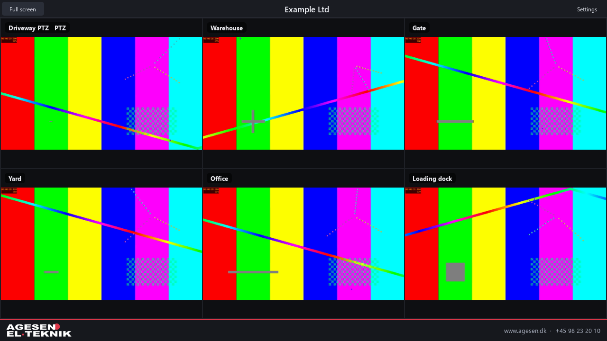
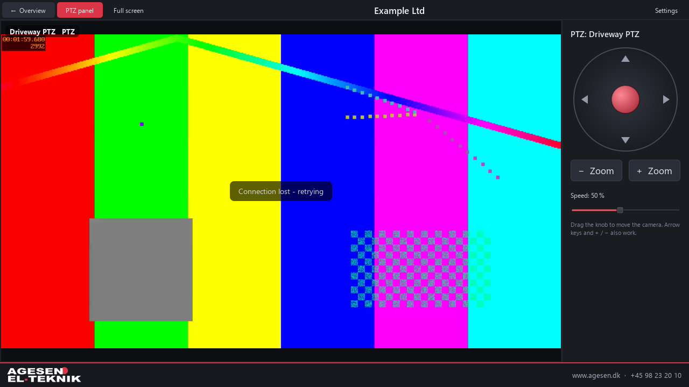

# Agesen CamView

[](LICENSE)

Lightweight Windows viewer for up to 32 Hikvision IP cameras, with an on-screen
PTZ joystick. No browser, no plugins, no web components.



## Features

- **Up to 32 cameras**, spread over as many pages as needed, with 4, 6, 9 or 16
  cameras per page. With two cameras set up, the viewer shows those two.
- **Click a camera** to show it alone in the whole window in full quality.
  Click again or press `Esc` to go back to the overview.
- **PTZ control** in the single view, with an on-screen joystick, zoom buttons
  and a speed slider. Arrow keys and `+` / `−` work too. PTZ is detected
  automatically, directly on the camera or through an NVR.
- **Network discovery** of Hikvision devices (SADP). Add several cameras at
  once; the login of the selected camera is reused, as most sites share one.
- **NVR channels:** add an NVR and copy it with the next channel number for
  each camera behind it.
- **Automatic stream selection:** sub stream in the overview, main stream in
  the single view. Only the cameras on the current page are streamed.
- **Saved setup** with passwords encrypted by Windows DPAPI.
- **Danish and English**, switchable at runtime. The first start follows the
  Windows display language.
- **Customer name** shown at the top of the window.
- **Safe with wrong passwords:** the viewer does not retry a failed login,
  because Hikvision devices lock out an IP address after a few failed attempts.



## Requirements

- Windows 10 or 11, 64-bit
- Hikvision cameras or NVRs with RTSP (port 554) and ISAPI over HTTP (port 80)
  enabled. A user with live view rights; PTZ control also needs PTZ rights.

## Installation

Download `AgesenCamView-Setup-<version>.exe` from
[Releases](../../releases) and run it.

- Everything the program needs is included (Python, Qt, FFmpeg and the
  Microsoft C++ runtime).
- Installs per user in `%LOCALAPPDATA%\Programs\AgesenCamView`. No administrator
  rights needed. Adds a Start menu shortcut and, optionally, a desktop shortcut.
- The installer asks for the language and the customer name.
- The package contains no camera setup; a new PC starts empty. On a PC where
  Agesen CamView was installed before, the installer can start fresh.
- An earlier version installed under the name HikViewer is removed
  automatically, and its cameras and settings are kept.
- Uninstall from **Settings → Apps → Installed apps**.

The executables are not code-signed. On first run, Windows SmartScreen may show
"Windows protected your PC"; choose **More info → Run anyway**.

### Silent install

```bat
AgesenCamView-Setup-1.2.0.exe --silent --customer "Customer name" --lang en
```

| Option | Meaning |
|---|---|
| `--dir PATH` | Install folder (default `%LOCALAPPDATA%\Programs\AgesenCamView`) |
| `--customer NAME` | Customer name shown at the top |
| `--lang da\|en` | Language |
| `--no-desktop` | No desktop shortcut |
| `--reset` | Delete an earlier camera setup on this PC |

The installer writes a log to `%TEMP%\AgesenCamView-Setup.log`.
Silent uninstall: `AgesenCamView.exe --uninstall --silent`
(add `--purge` to delete the saved setup as well).

## Usage

| Action | Result |
|---|---|
| Click a camera | Show it alone in the whole window |
| Click again, `Esc` or **← Overview** | Back to the overview |
| `◀` `▶`, `Page Up` / `Page Down`, `←` / `→` | Previous / next page (overview) |
| Joystick, zoom buttons, arrow keys, `+` / `−` | PTZ control (single view of a PTZ camera) |
| `F11` | Full screen; `Esc` leaves it |

The program runs in one window at a time.

## Settings

| Setting | Meaning |
|---|---|
| Customer name | Shown in the centre of the toolbar and in the window title |
| Language | Danish or English |
| Cameras per page | 4, 6, 9 or 16 |
| Camera list | Add, copy (next channel), search the network, remove, move up/down |
| Name, IP address, ports | HTTP (ISAPI, default 80) and RTSP (default 554) |
| User name, password | Camera or NVR login |
| Channel | `1` for a camera. For an NVR: the camera's channel number in the recorder |
| Video quality | Automatic (recommended), main stream or sub stream |

**Test connection** logs in and shows the model and PTZ support.

The setup is stored in `%APPDATA%\AgesenCamView\config.json`. Passwords are
encrypted with Windows DPAPI and can only be read by the same Windows user on
the same PC, so the file cannot be copied to another PC with its passwords.

## Building from source

Requires Python 3.13 on Windows.

```bat
pip install -r requirements.txt
python build_installer.py
```

This builds the program (`build.bat` → `dist\AgesenCamView\`) and then the
installer `dist\AgesenCamView-Setup-<version>.exe`. The version number is in
`camview/__init__.py`. Run from source with `python run.py`.

| Path | Contents |
|---|---|
| `camview/` | The application (PySide6) |
| `installer/setup.py` | The installer (tkinter, packed with PyInstaller) |
| `assets/` | Icon and logo files; `make_logo.py` regenerates the logo |
| `build.bat`, `build_installer.py` | Build scripts |

### How it works

- **Video:** RTSP over TCP (`/Streaming/Channels/<channel>01` main,
  `…02` sub) decoded with FFmpeg through PyAV, one thread per camera.
- **PTZ:** ISAPI `PUT /ISAPI/PTZCtrl/channels/<channel>/continuous` with digest
  authentication, or `/ISAPI/ContentMgmt/PTZCtrlProxy/…` through an NVR. Only
  the latest joystick position is sent, at most about 8 times per second, and a
  stop command is always sent on release.
- **Discovery:** SADP multicast probe on UDP 37020.
- **Texts:** `camview/i18n.py` (Danish and English).

## Branding

The bottom bar shows the Agesen EL-Teknik logo and contact details. It is fixed
in the code (`camview/brand.py` and the embedded logo in
`camview/brand_logo.py`) and cannot be changed from the program. Only the
customer name at the top is configurable.

## Third-party software

The installer bundles third-party components under their own licenses,
including Qt / PySide6 (LGPLv3) and FFmpeg (via PyAV). See
[THIRD_PARTY_NOTICES.md](THIRD_PARTY_NOTICES.md).

## License

Agesen CamView is free software: you can redistribute it and/or modify it under
the terms of the GNU General Public License as published by the Free Software
Foundation, either version 3 of the License, or (at your option) any later
version. See [LICENSE](LICENSE).

**Trademarks (additional term under GPLv3 section 7(e)):** the GPL does not
grant any rights to the name "Agesen EL-Teknik" or to the Agesen EL-Teknik logo
(`assets/logo-*.png`, `camview/brand_logo.py`). Modified versions distributed by
others must not use the name or logo in a way that suggests they come from
Agesen EL-Teknik; replace `camview/brand.py` and `camview/brand_logo.py` with
your own branding.

## Disclaimer

Agesen CamView is an independent project by Agesen EL-Teknik. It is not affiliated
with, endorsed by or sponsored by Hangzhou Hikvision Digital Technology Co.,
Ltd. "Hikvision" is a trademark of its respective owner and is used here only
to describe compatibility.

## Contact

Agesen EL-Teknik · [www.agesen.dk](https://www.agesen.dk) · +45 98 23 20 10
